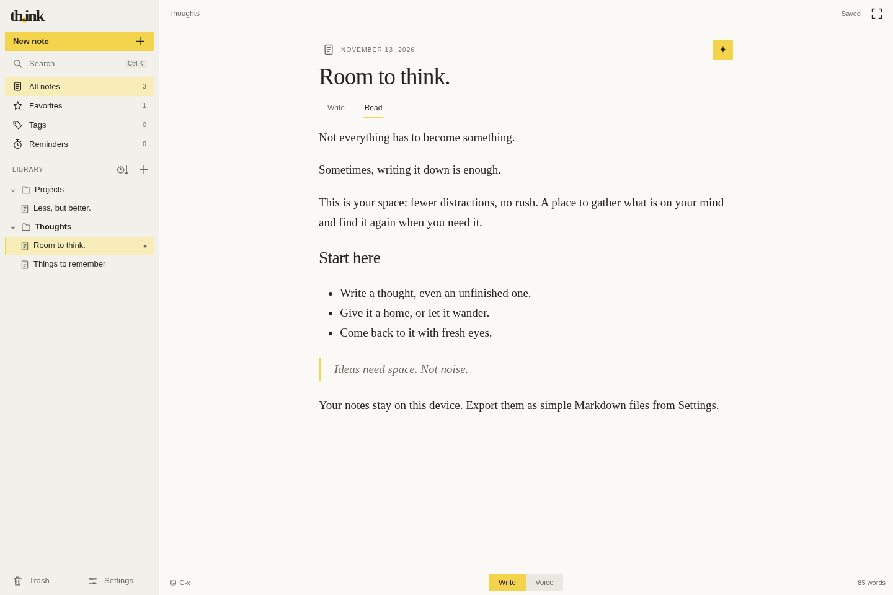

# th.ink

A quiet place to think. Markdown, voice, and very little else.

## Make room for your thoughts

- Write in Markdown. Keep the syntax visible, see the formatting as you type.
- Choose a font for your notes. Code stays monospace, with offline syntax highlighting.
- Switch between writing and offline dictation, in English or Italian.
- Go into focus mode. Just the page and the controls you need.
- Organize notes with folders, favorites, tags, and emoji.
- Right-click for actions. Drag to move, undo a move, or restore from the trash.
- Set reminders, including recurring ones.
- Turn a folder into a static journal. Export one ZIP, with search, RSS, and SEO metadata.
- Search offline. Keep revisions. Import and export Markdown.

Light, dark, or system theme. Phone, tablet, or desktop.

## Your notes, your space

Notes live in your browser. No account is needed for writing.
Optional Filen sync encrypts your archive before uploading it.
Speech recognition and synthesis run on your device.

Remote reminders use a separate, single-owner PHP backend. It stores reminder
text, schedules, note titles and identifiers, and device subscriptions—not full
note bodies. A push service accepting a notification does not guarantee that
your device will display it.

Journal exports contain only the selected folder and its subfolders. Nothing
is uploaded automatically. Keep backups of notes you want to keep.

## Under the surface

Plain HTML, CSS, and JavaScript. CodeMirror for editing. C/WebAssembly for search.
`src/` contains the source. The build generates `dist/`, ready to upload.
Generated files stay out of Git.
Private configuration, credentials, databases, backups, and downloaded dependencies
are excluded from Git.

## License

Original code: [MIT](LICENSE). Third-party components keep their own licenses,
including GPL-3.0 and AGPL-3.0. See [THIRD_PARTY.md](THIRD_PARTY.md).
